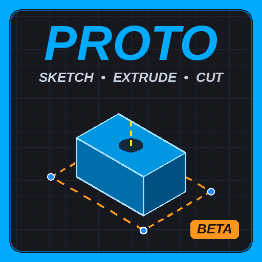

# PROTO - CAD Builder for Roblox Studio (Sketch • Cut • Extrude)

**Free and open source (GPL-3.0).** Sketch a shape with real sizes, extrude it, cut holes, round the edges, pattern it - and change any number later to rebuild the part. Made for exact parts and map pieces: walls, frames, stairs, rails, panels, doors, anything that's slow with Move / Scale / Union.

## Install

**Option A - Creator Store (easiest):** search **PROTO (Sketch to Build)** on the Creator Store, or open
https://create.roblox.com/store/asset/124557362882102 - it's free.
> Roblox doesn't let plugins installed from the Creator Store save meshes yet, so the store copy builds with normal parts. Everything else works.

**Option B - from the file (full version, saves meshes):**
1. Download the newest `PROTO_v*_RELEASE.rbxmx` from [Releases](../../releases) (or from the `releases/` folder).
2. In Studio: **Plugins tab → Plugins Folder**, and put the file in there.
3. Restart Studio. PROTO appears in the Plugins tab.
4. For mesh saving: **File → Beta Features → "CreateAssetAsync Lua API"**, and in your place **Game Settings → Security → Allow Mesh / Image APIs** (the place must be published).

## What it does
- **Sketch:** lines, rectangles, circles, slots, polygons, arcs, splines. Snapping, and type exact sizes. Sketch on any face (Shift + click) or on movable planes.
- **Build:** Extrude and Cut with a live preview, Revolve, Shell, Mirror. Each shape is ONE clean mesh - no unions, no seams.
- **Edges:** chamfers and smooth rounds on any edge.
- **Pattern:** a live Linear pattern with handles on the last copy - yellow balls add / remove copies, red / green / blue arrows = spacing / stairs / slant, stretch balls grow the copies along the row (Ctrl = both sides). Shift-click to add parts. Circular, copy round and copy along too.
- **Paint:** colour and material per face, your own materials.
- **Edit later:** every step is kept in the FEATURES list - double-click a cut, change it, and the part rebuilds. CLEAN UP takes out steps that can't be made. Ctrl+Z undoes the look and the data together.

The same pattern everywhere: **pick → drag (live preview) → type a number if you want → Enter = done, Esc = cancel.**

## Known issues
PROTO's cutting engine is home-made. It's much sturdier than it was (v3.94-v4.00), but on complicated parts a cut or a round can still be refused ("the shape came out broken" / "left out") - your part is always kept as it was. If that happens, please open an **Issue** with the recipe PROTO prints to Output. A stronger engine (the Manifold approach, Apache-2.0) is the big upgrade waiting to be done - help welcome.

## Bugs, ideas, help
- **Issues** on this repo - say your version (top of the PROTO panel), what you did, what went wrong; a screenshot helps.
- TikTok: **@cruppnomics** · Discord: see the Creator Store page.

## The code
- `src/proto_src.lua` - the source (one file).
- `build/DIMPlugin.lua` - the built plugin.
- `releases/` - every released `.rbxmx`.
- `docs/releases.md` - what changed in each version.
- `tools/` - small Python scripts used to build releases.

Pull requests are welcome. Keep the GPL notice and credits in copies (that's what the licence asks).

## Licence
Copyright (C) 2026 Giga_gad27 (Cruppnomics).
This program is free software: you can redistribute it and/or modify it under the terms of the **GNU General Public License** as published by the Free Software Foundation, either version 3 of the License, or (at your option) any later version. It is distributed WITHOUT ANY WARRANTY - see [`LICENSE`](LICENSE).

What you **build** with PROTO (your parts, models and games) is yours - the licence covers PROTO's code, not your creations.
